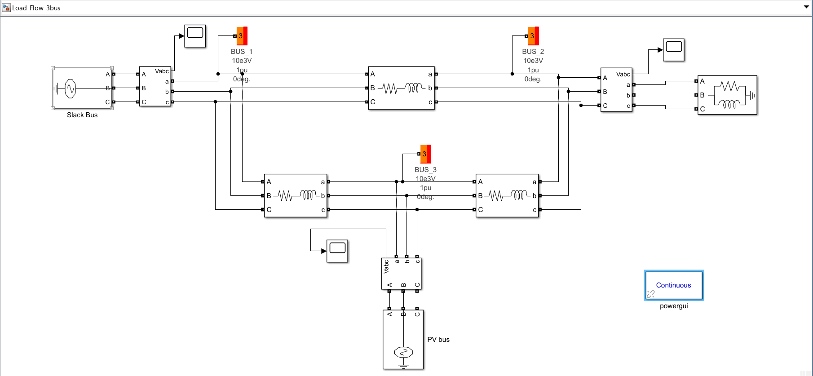
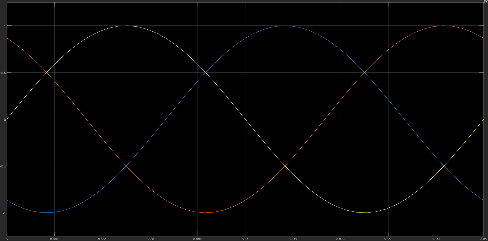
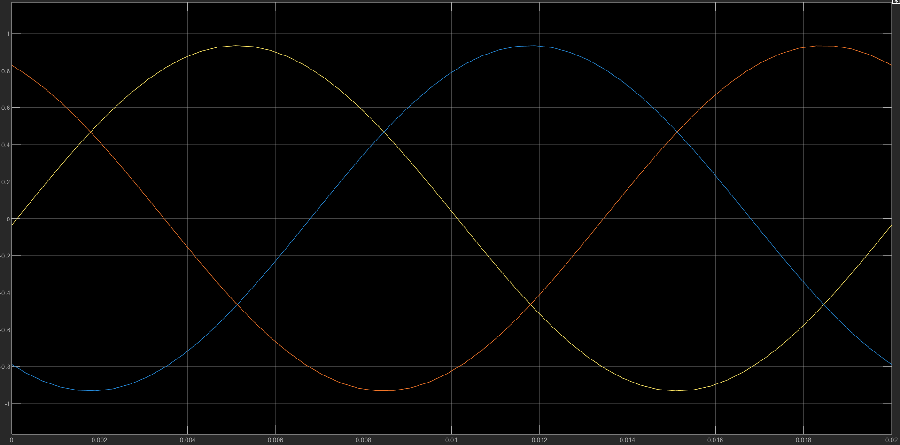
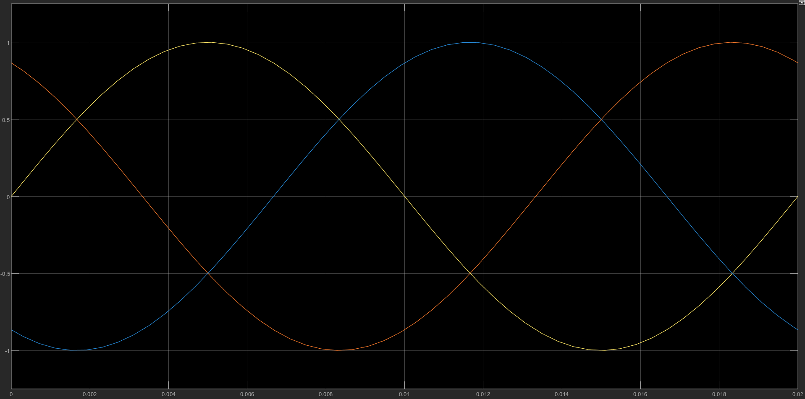

# Three-Bus Load Flow Analysis using MATLAB/Simulink

## Project Overview

This project focuses on the steady-state analysis of a three-bus electrical power system using MATLAB/Simulink and Specialized Power Systems.

The objective is to study power distribution across an interconnected power network, analyse bus voltage magnitudes and phase angles, and understand the impact of transmission-line impedance and load demand on system performance.

The network consists of two three-phase sources, three interconnected buses, three transmission-line branches represented by series resistance and inductance (RL), and a three-phase constant-PQ load.

Load-flow analysis is performed using the Powergui Load Flow Analyzer and the Newton-Raphson method.

## Simulink Model

## System Configuration

| Component | Configuration |
|---|---|
| Number of buses | 3 |
| Number of sources | 2 |
| Number of transmission lines | 3 |
| Load type | Three-Phase Constant PQ |
| Nominal voltage | 10 kV |
| Operating frequency | 50 Hz |
| Load Flow Base Power | 100 MVA |
| Load Flow Method | Newton-Raphson |
| Simulation Environment | MATLAB/Simulink |

## Bus Configuration

The three buses are configured as follows:

| Bus | Bus Type | Specified Parameters |
|---|---|---|
| BUS_1 | Slack / Swing Bus | Voltage = 1.05 pu, Angle = 0° |
| BUS_2 | PQ Bus | P = 400 MW, Q = 250 MVAr |
| BUS_3 | PV Bus | P = 200 MW, Voltage = 1.04 pu |

### Bus Functions

- **Slack Bus (BUS_1):** Establishes the reference voltage magnitude and phase angle and balances the system's active and reactive power mismatch.
- **PQ Bus (BUS_2):** Represents the load connection point with specified active and reactive power demand.
- **PV Bus (BUS_3):** Represents a generator bus with specified active power and voltage magnitude, while reactive power and phase angle are calculated.

## Transmission Line Parameters

The three transmission lines are represented using Three-Phase Series RLC Branch blocks configured as RL branches.

| Transmission Line | Connection | Resistance (Ω) | Reactance at 50 Hz (Ω) |
|---|---|---:|---:|
| Line 1 | BUS_1 – BUS_2 | 0.0200 | 0.0400 |
| Line 2 | BUS_1 – BUS_3 | 0.0100 | 0.0300 |
| Line 3 | BUS_3 – BUS_2 | 0.0125 | 0.0250 |

The series resistance represents active power losses, while inductance represents the magnetic characteristics of the transmission lines and contributes to reactive power absorption.

## Load Configuration

The Three-Phase Parallel RLC Load is connected at BUS_2.

| Parameter | Value |
|---|---:|
| Nominal Voltage | 10 kV |
| Frequency | 50 Hz |
| Active Power | 400 MW |
| Inductive Reactive Power | 250 MVAr |
| Connection | Y-Grounded |
| Load Type | Constant PQ |

The calculated apparent power is approximately 471.70 MVA, with a lagging power factor of 0.848.

## Load Flow Methodology

The Powergui Load Flow Analyzer is used to calculate the steady-state operating condition of the network.

The calculation involves:

1. Defining the three-bus network topology and electrical connections.
2. Specifying the slack, PV and PQ bus parameters.
3. Defining transmission-line resistance and reactance.
4. Forming the network admittance (Y-bus) matrix.
5. Solving the nonlinear load-flow equations using the Newton-Raphson method.
6. Obtaining bus voltage magnitudes, voltage phase angles, generator power outputs, line power flows and network losses.

## Load Flow Results

The load-flow calculation converged successfully in **2 iterations**.

### 1. Bus Voltage Profile

| Bus | Bus Type | Voltage (pu) | Voltage (kV) | Phase Angle |
|---|---|---:|---:|---:|
| BUS_1 | Slack | 1.050 | 10.50 | 0.00° |
| BUS_2 | PQ | 0.972 | 9.72 | -2.70° |
| BUS_3 | PV | 1.040 | 10.40 | -0.50° |

BUS_2 experiences a lower voltage magnitude than the other two buses, reflecting its location at the load connection point and the effect of network impedance.

### 2. Generation Results

| Generator Bus | Active Power (MW) | Reactive Power (MVAr) |
|---|---:|---:|
| BUS_1 (Slack) | 218.423501 | 140.845005 |
| BUS_3 (PV) | 200.000040 | 146.203499 |
| **Total Generation** | **418.423541** | **287.048505** |

The slack generator supplies the remaining active and reactive power required to balance the network.

### 3. Load Results

| Load Bus | Active Power (MW) | Reactive Power (MVAr) |
|---|---:|---:|
| BUS_2 | 399.999913 | 249.999746 |

The calculated load values closely match the specified load demand of 400 MW and 250 MVAr.

### 4. Transmission Line Power Flow and Losses

Power flows at both ends of each transmission line are compared to calculate active power losses and net reactive power absorption.

| Transmission Line | Sending P (MW) | Receiving P (MW) | Active Power Loss (MW) |
|---|---:|---:|---:|
| BUS_1 – BUS_2 | 179.361756 | 170.968195 | 8.393561 |
| BUS_1 – BUS_3 | 39.061745 | 38.879023 | 0.182722 |
| BUS_3 – BUS_2 | 238.879062 | 229.031718 | 9.847344 |
| **Total** | | | **18.423627** |

Line 3 has the highest active power loss, followed by Line 1. Line 2 has comparatively lower power loss.

The net reactive power absorption across the transmission lines is approximately 37.048759 MVAr.

### 5. Overall Power Balance

| Parameter | Active Power (MW) | Reactive Power (MVAr) |
|---|---:|---:|
| Total Generation | 418.423541 | 287.048505 |
| Total Load | 399.999913 | 249.999746 |
| Total Network Absorption / Losses | 18.423627 | 37.048759 |

The active power balance is:

P_generation = P_load + P_losses

418.423541 = 399.999913 + 18.423627 (approximately)

This confirms that the generated active power supplies the load demand and the active power losses in the network.

## Simulation Waveforms

Three-Phase Voltage Waveforms are monitored at all three buses using Three-Phase V-I Measurement blocks and Simulink Scopes.

### BUS_1 Voltage Waveforms

### BUS_2 Voltage Waveforms

### BUS_3 Voltage Waveforms

The voltage waveforms represent the three-phase AC voltage signals at the respective buses. They allow observation of the phase relationships and sinusoidal nature of the system voltages.

## Tools and Technologies

- MATLAB
- Simulink
- Simscape Electrical / Specialized Power Systems
- Powergui Load Flow Analyzer
- Newton-Raphson Load Flow Method

## How to Run the Model

1. Download or clone this repository.
2. Open MATLAB and navigate to the project directory.
3. Open the Simulink model located in the `model` folder.
4. Ensure the required Simscape Electrical / Specialized Power Systems libraries are available.
5. Verify that the Powergui load-flow frequency is set to 50 Hz.
6. Open Powergui and select Load Flow Analyzer.
7. Update the network parameters and compute the load flow.
8. View the bus voltage and phase-angle results, generation report, load report and transmission-line power flows.

## Project Scope and Limitations

- The project represents a simplified three-bus power network.
- Transmission lines are modelled using lumped series RL branches.
- The PV and slack sources are simplified three-phase source representations, not detailed synchronous-machine dynamic models.
- The study focuses on steady-state load-flow analysis rather than transient stability or fault analysis.
- Reactive power limits on the PV source are set to infinity in the current model.
- The voltage waveforms are monitored separately from the numerical load-flow reports.

## Repository Contents

- `model/` – MATLAB/Simulink model.
- `images/` – Simulink block diagram and three-phase voltage waveform screenshots.
- `results/` – Excel workbook containing all load-flow result sheets.
- `README.md` – Project description, system configuration, methodology and results.
